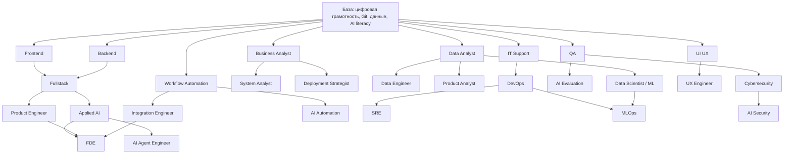

# Карта переходов

Стрелки — возможные переходы, а не обязательные карьерные ступени. Для более узких ролей смотрите отдельные roadmaps.

- [Frontend Engineer](roadmaps/frontend.md): Fullstack / UX Engineer / Product Engineer
- [Backend Engineer](roadmaps/backend.md): Fullstack / Data Engineer / FDE
- [Fullstack Engineer](roadmaps/fullstack.md): Product Engineer / Applied AI / FDE
- [Mobile Engineer](roadmaps/mobile.md): Fullstack / Mobile product engineer
- [Product Engineer](roadmaps/product-engineer.md): Fullstack → Product Engineer → FDE
- [UX Engineer](roadmaps/ux-engineer.md): Frontend / UI UX / Product Engineer
- [UI/UX Designer](roadmaps/ui-ux-designer.md): UX Engineer / Product Manager
- [Applied AI Engineer](roadmaps/applied-ai.md): Backend / Fullstack → Applied AI → FDE
- [AI Agent Engineer](roadmaps/ai-agent.md): Applied AI / Automation → Agent Engineer
- [AI Evaluation Engineer](roadmaps/ai-evaluation.md): QA / Data Analyst → AI Evaluation
- [ML Engineer](roadmaps/ml-engineer.md): Data Scientist / Backend → ML Engineer → MLOps
- [MLOps / AI Platform Engineer](roadmaps/mlops.md): DevOps / ML Engineer → MLOps
- [Workflow Automation Engineer](roadmaps/workflow-automation.md): AI Automation / Integration / FDE
- [AI Automation Engineer](roadmaps/ai-automation.md): Workflow Automation / Applied AI / FDE
- [Low-code Application Developer](roadmaps/low-code.md): Automation / Business Analyst / Fullstack
- [RPA Developer](roadmaps/rpa.md): Automation / Business Process Analyst
- [Integration Engineer](roadmaps/integration.md): Backend / Automation → FDE / Solution Architect
- [Conversational AI Developer](roadmaps/conversational-ai.md): Automation / UX / Applied AI
- [Business Analyst](roadmaps/business-analyst.md): System Analyst / Product / Deployment Strategist
- [System Analyst](roadmaps/system-analyst.md): Backend / BA → System Analyst → Architect
- [Product Manager](roadmaps/product-manager.md): BA / Data Analyst / Product Engineer → PM
- [Product Analyst](roadmaps/product-analyst.md): Data Analyst / PM
- [IT Project Manager / Delivery](roadmaps/project-manager.md): BA / Support → PM / Delivery Lead
- [Data / BI Analyst](roadmaps/data-analyst.md): Product Analyst / Data Engineer / Data Scientist
- [Data Engineer](roadmaps/data-engineer.md): Backend / BI → Data Engineer → MLOps
- [Data Scientist](roadmaps/data-scientist.md): Data Analyst → Data Scientist → ML Engineer
- [QA Automation Engineer](roadmaps/qa-automation.md): AI Evaluation / SDET / Security
- [Cybersecurity Analyst / Engineer](roadmaps/cybersecurity.md): DevOps / QA → Cybersecurity → AI Security
- [AI Security Engineer](roadmaps/ai-security.md): Cybersecurity / Applied AI → AI Security
- [AI Governance / AI Risk Specialist](roadmaps/ai-governance.md): BA / Security / Compliance → AI Governance
- [DevOps / Cloud Engineer](roadmaps/devops.md): Backend / Sysadmin → DevOps → SRE/MLOps
- [Site Reliability Engineer / Platform Engineer](roadmaps/sre.md): DevOps / Backend → SRE
- [Forward Deployed Engineer](roadmaps/fde.md): Fullstack / Applied AI / Integration → FDE
- [AI Solutions Engineer / Architect](roadmaps/ai-solutions.md): Backend / FDE / Applied AI → Solutions Architect
- [Deployment Strategist / AI Implementation](roadmaps/deployment-strategist.md): BA / Automation / Product → Deployment Strategist
- [ERP / CRM Implementation Specialist](roadmaps/erp-crm.md): BA / Automation → Integration / Deployment
- [IT Support / Customer Engineer](roadmaps/tech-support.md): DevOps / Integration / Customer Success
- [Embedded / IoT Engineer](roadmaps/embedded-iot.md): Backend / Systems → IoT
- [Game Developer](roadmaps/game-dev.md): Mobile / Graphics / Gameplay Engineer
