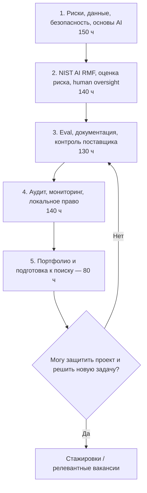

# AI Governance / AI Risk Specialist

[← Карьерный навигатор](../README.md) · [Методология рынка](../MARKET-RESEARCH.md)

> Обновлено 24.11.2026. Формирующаяся / нишевая специализация. Часы — редакционная оценка учебной нагрузки с нуля, включая практику, а не результат исследования. Стажировка и трудоустройство не гарантированы.

## Что это за работа

Специалист применяет компетенции в области «Безопасность», чтобы поставлять проверяемые результаты. Типичный учебный результат, отражающий обязанности: AI risk assessment: реестр, контрольные меры, владельцы и мониторинг. На работе задачи включают nist ai rmf, оценка риска, human oversight, eval, документация, контроль поставщика и аудит, мониторинг, локальное право. Конкретный набор зависит от работодателя.

**Кому подойдёт:** тем, кому интересны nist ai rmf, оценка риска, human oversight и eval, документация, контроль поставщика. Попробуйте первое задание ниже, прежде чем покупать обучение.

**Порог входа:** выше среднего; лучше начинать со смежной роли или стажировки, а эту профессию считать целью после практического опыта. Нужна готовность учиться самостоятельно; английский для документации, международный рынок — обычно рабочий английский.

## Рынок и зарплаты

Отдельной сопоставимой статистики вакансий и медианной зарплаты по этой должности в Казахстане и СНГ в изученных агрегированных отчётах нет.

Если категория шире названия роли, отдельная медиана по роли неизвестна. Не переносите цифру прокси на эту профессию.

**Прогноз (редакционный, не измерение):** 2027: развитие вероятно при сохранении инвестиций в интеграции, качество и безопасность; не обещание роста вакансий. 2028–2030: возможна специализация на автономных процессах, но названия и обязанности могут измениться.

**Ограничения:** Часто требуется compliance/аудит опыт; правовые требования зависят от страны.

## Roadmap с нуля

| Этап | Что изучить | Часы | Практика и контроль результата |
|---|---|---:|---|
| 1 | Риски, данные, безопасность, основы AI | 150 | Создать инвентаризацию моделей и данных |
| 2 | NIST AI RMF, оценка риска, human oversight | 140 | Составить risk register для AI помощника |
| 3 | Eval, документация, контроль поставщика | 130 | Собрать evidence pack и правила эскалации |
| 4 | Аудит, мониторинг, локальное право | 140 | Спроектировать процедуру review и инцидентов |
| 5 | Портфолио, резюме, интервью, анализ вакансий | 80 | Завершить capstone, провести пробное собеседование и исправить пробелы |

**Всего около 640 ч** (плановая оценка, разумный диапазон ±25%; без коммерческого опыта). При 10 ч/нед — примерно 64 недель; при 20 ч/нед — 32 недель. Опытный специалист пропускает только этапы, которые может подтвердить самостоятельной практикой. Для продвинутых ролей коммерческий опыт может потребоваться сверх этой оценки.

### Как заниматься

- Сначала прочитать документацию и выполнить маленькое задание самостоятельно; затем попросить AI проверить решение, а не выдать ответ.
- Вести Git-репозиторий или журнал решений: задача, варианты, ошибки, вывод. Использовать только учебные либо разрешённые обезличенные данные.
- В конце каждого этапа воспроизвести работу без подсказок и объяснить ограничения решения. Если не получается — повторить практику.

## Ресурсы (приоритет бесплатным)

- [NIST AI RMF](https://www.nist.gov/itl/ai-risk-management-framework) — документация или учебный портал; базовые материалы доступны без покупки, отдельные функции/экзамены могут быть платными.
- [OECD AI principles](https://oecd.ai/en/ai-principles) — документация или учебный портал; базовые материалы доступны без покупки, отдельные функции/экзамены могут быть платными.
- [ISO AI](https://www.iso.org/artificial-intelligence) — документация или учебный портал; базовые материалы доступны без покупки, отдельные функции/экзамены могут быть платными.

Платный вариант: ментор или курс с проверяемой программой по тем же этапам, проектом, обратной связью и прозрачным договором; сравните с бесплатными ресурсами. Платное обучение и сертификат не гарантируют качество, навыки или найм. Облачные сервисы/API, экзамены и тарифы могут требовать оплаты; проверяйте условия до регистрации.

## Портфолио

**Capstone:** AI risk assessment: реестр, контрольные меры, владельцы и мониторинг.

1. Сформулировать проблему, пользователя и проверяемый критерий успеха; явно отметить учебный/синтетический характер проекта.
2. Выполнить 4 этапных мини-задания; собрать их в единый проект, указать архитектуру/процесс и принятые решения.
3. Продемонстрировать обычный сценарий и минимум три отказа/ошибки; приложить доказательства тестов, измерения или обратной связи.
4. Опубликовать README, инструкцию воспроизведения, короткое демо и ограничения; не публиковать секреты и чужие данные.

## Готовность к рынку

- [ ] Отличаешь стандарт от закона, документируешь доказательства и границы.
- [ ] Могу выполнить итоговое задание без AI-подсказок и объяснить каждое ключевое решение.
- [ ] Есть воспроизводимый проект, документация, проверки и список известных ограничений.
- [ ] Изучил 20–30 релевантных объявлений; выделил обязательные навыки, опыт и географические ограничения; сравнил со своими доказательствами.
- [ ] Подготовил резюме с фактами и ссылками на работы, а не выдуманным опытом; прошёл пробное интервью.

**Поисковые запросы:** AI governance, AI risk, responsible AI (на русском и английском). [hh.kz](https://hh.kz/), [hh.uz](https://hh.uz/), [hh.ru](https://hh.ru/), [Хабр Карьера](https://career.habr.com/), [LinkedIn Jobs](https://www.linkedin.com/jobs/). Для международных вакансий проверяйте страну, право на работу, язык, удалённый формат и условия оплаты.

**Переходы:** BA / Security / Compliance → AI Governance.

## Источники рынка

- [KZ26] [hh.kz — III квартал 2026](https://hh.kz/article/34483)
- [WEF] [WEF — Future of Jobs Report 2025](https://www.weforum.org/publications/the-future-of-jobs-report-2025/)

[Все источники и методология](../SOURCES.md)
