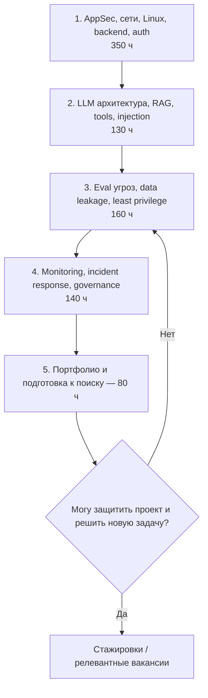

# AI Security Engineer

[← Карьерный навигатор](../README.md) · [Методология рынка](../MARKET-RESEARCH.md)

> Обновлено 24.11.2026. Формирующаяся / нишевая специализация. Часы — редакционная оценка учебной нагрузки с нуля, включая практику, а не результат исследования. Стажировка и трудоустройство не гарантированы.

## Что это за работа

Специалист применяет компетенции в области «Безопасность», чтобы поставлять проверяемые результаты. Типичный учебный результат, отражающий обязанности: Безопасный AI-агент: threat model, негативные тесты, разрешения, отчёт. На работе задачи включают llm архитектура, rag, tools, injection, eval угроз, data leakage, least privilege и monitoring, incident response, governance. Конкретный набор зависит от работодателя.

**Кому подойдёт:** тем, кому интересны llm архитектура, rag, tools, injection и eval угроз, data leakage, least privilege. Попробуйте первое задание ниже, прежде чем покупать обучение.

**Порог входа:** выше среднего; лучше начинать со смежной роли или стажировки, а эту профессию считать целью после практического опыта. Нужна готовность учиться самостоятельно; английский для документации, международный рынок — обычно рабочий английский.

## Рынок и зарплаты

**Смежная категория, НЕ отдельная статистика роли:** «Специалист по информационной безопасности». hh.kz, 2025: доля 3.3% IT-вакансий; изменение к 2024: +24.5%; медианное предложение 231 523 ₸/мес. hh.uz, 2025: доля 3%; изменение +48.2%; медианное предложение 5 729 189 сум/мес. [KZ25, UZ25]. Все грейды; это не зарплата новичка.

Россия, I полугодие 2026, самоотчёты Хабр Карьеры: ИБ — Москва 224 000 ₽, регионы 130 000 ₽. Это широкая категория, не отдельная роль и не предложения вакансий. [RU26]

Если категория шире названия роли, отдельная медиана по роли неизвестна. Не переносите цифру прокси на эту профессию.

**Прогноз (редакционный, не измерение):** 2027: развитие вероятно при сохранении инвестиций в интеграции, качество и безопасность; не обещание роста вакансий. 2028–2030: возможна специализация на автономных процессах, но названия и обязанности могут измениться.

**Ограничения:** Специализация поверх AppSec/AI; отдельная локальная статистика отсутствует.

## Roadmap с нуля

| Этап | Что изучить | Часы | Практика и контроль результата |
|---|---|---:|---|
| 1 | AppSec, сети, Linux, backend, auth | 350 | Сделать threat model своего API |
| 2 | LLM архитектура, RAG, tools, injection | 130 | Описать доверительные границы агента |
| 3 | Eval угроз, data leakage, least privilege | 160 | Тестировать собственную лабораторию и фильтры |
| 4 | Monitoring, incident response, governance | 140 | Создать журнал, approval и kill switch |
| 5 | Портфолио, резюме, интервью, анализ вакансий | 80 | Завершить capstone, провести пробное собеседование и исправить пробелы |

**Всего около 860 ч** (плановая оценка, разумный диапазон ±25%; без коммерческого опыта). При 10 ч/нед — примерно 86 недель; при 20 ч/нед — 43 недель. Опытный специалист пропускает только этапы, которые может подтвердить самостоятельной практикой. Для продвинутых ролей коммерческий опыт может потребоваться сверх этой оценки.

### Как заниматься

- Сначала прочитать документацию и выполнить маленькое задание самостоятельно; затем попросить AI проверить решение, а не выдать ответ.
- Вести Git-репозиторий или журнал решений: задача, варианты, ошибки, вывод. Использовать только учебные либо разрешённые обезличенные данные.
- В конце каждого этапа воспроизвести работу без подсказок и объяснить ограничения решения. Если не получается — повторить практику.

## Ресурсы (приоритет бесплатным)

- [OWASP GenAI](https://genai.owasp.org/) — документация или учебный портал; базовые материалы доступны без покупки, отдельные функции/экзамены могут быть платными.
- [NIST AI RMF](https://www.nist.gov/itl/ai-risk-management-framework) — документация или учебный портал; базовые материалы доступны без покупки, отдельные функции/экзамены могут быть платными.
- [PortSwigger](https://portswigger.net/web-security) — документация или учебный портал; базовые материалы доступны без покупки, отдельные функции/экзамены могут быть платными.

Платный вариант: ментор или курс с проверяемой программой по тем же этапам, проектом, обратной связью и прозрачным договором; сравните с бесплатными ресурсами. Платное обучение и сертификат не гарантируют качество, навыки или найм. Облачные сервисы/API, экзамены и тарифы могут требовать оплаты; проверяйте условия до регистрации.

## Портфолио

**Capstone:** Безопасный AI-агент: threat model, негативные тесты, разрешения, отчёт.

1. Сформулировать проблему, пользователя и проверяемый критерий успеха; явно отметить учебный/синтетический характер проекта.
2. Выполнить 4 этапных мини-задания; собрать их в единый проект, указать архитектуру/процесс и принятые решения.
3. Продемонстрировать обычный сценарий и минимум три отказа/ошибки; приложить доказательства тестов, измерения или обратной связи.
4. Опубликовать README, инструкцию воспроизведения, короткое демо и ограничения; не публиковать секреты и чужие данные.

## Готовность к рынку

- [ ] Объясняешь остаточный риск; не считаешь фильтр промпта полноценной защитой.
- [ ] Могу выполнить итоговое задание без AI-подсказок и объяснить каждое ключевое решение.
- [ ] Есть воспроизводимый проект, документация, проверки и список известных ограничений.
- [ ] Изучил 20–30 релевантных объявлений; выделил обязательные навыки, опыт и географические ограничения; сравнил со своими доказательствами.
- [ ] Подготовил резюме с фактами и ссылками на работы, а не выдуманным опытом; прошёл пробное интервью.

**Поисковые запросы:** AI security, LLM security, AI AppSec (на русском и английском). [hh.kz](https://hh.kz/), [hh.uz](https://hh.uz/), [hh.ru](https://hh.ru/), [Хабр Карьера](https://career.habr.com/), [LinkedIn Jobs](https://www.linkedin.com/jobs/). Для международных вакансий проверяйте страну, право на работу, язык, удалённый формат и условия оплаты.

**Переходы:** Cybersecurity / Applied AI → AI Security.

## Источники рынка

- [KZ26] [hh.kz — III квартал 2026](https://hh.kz/article/34483)
- [WEF] [WEF — Future of Jobs Report 2025](https://www.weforum.org/publications/the-future-of-jobs-report-2025/)
- [KZ25] [hh.kz — IT, итоги 2025](https://hh.kz/article/34221)
- [UZ25] [hh.uz — IT, итоги 2025](https://hh.uz/article/34221)
- [RU26] [Хабр Карьера — зарплаты, I полугодие 2026](https://habr.com/ru/specials/1060148/)

[Все источники и методология](../SOURCES.md)
