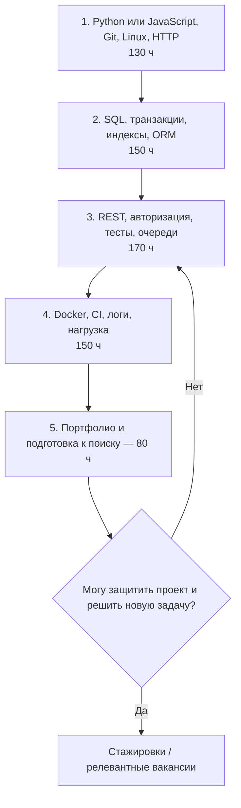

# Backend Engineer

[← Карьерный навигатор](../README.md) · [Методология рынка](../MARKET-RESEARCH.md)

> Обновлено 24.11.2026. Сформировавшаяся роль. Часы — редакционная оценка учебной нагрузки с нуля, включая практику, а не результат исследования. Стажировка и трудоустройство не гарантированы.

## Что это за работа

Специалист применяет компетенции в области «Разработка», чтобы поставлять проверяемые результаты. Типичный учебный результат, отражающий обязанности: Сервис бронирования: транзакции, TTL, RBAC, очереди, тесты. На работе задачи включают sql, транзакции, индексы, orm, rest, авторизация, тесты, очереди и docker, ci, логи, нагрузка. Конкретный набор зависит от работодателя.

**Кому подойдёт:** тем, кому интересны sql, транзакции, индексы, orm и rest, авторизация, тесты, очереди. Попробуйте первое задание ниже, прежде чем покупать обучение.

**Порог входа:** начальный путь возможен через стажировку, junior или смежную позицию; требования проверяются по вакансиям. Нужна готовность учиться самостоятельно; английский для документации, международный рынок — обычно рабочий английский.

## Рынок и зарплаты

**Смежная категория, НЕ отдельная статистика роли:** «Программист, разработчик». hh.kz, 2025: доля 20.1% IT-вакансий; изменение к 2024: -10.7%; медианное предложение 359 198 ₸/мес. hh.uz, 2025: доля 21.4%; изменение +5.5%; медианное предложение 8 890 151 сум/мес. [KZ25, UZ25]. Все грейды; это не зарплата новичка.

CoderPad 2026: 46% опрошенных рекрутеров планировали найм соответствующей категории (множественный выбор; не доля вакансий). [CP]

Россия, I полугодие 2026, самоотчёты Хабр Карьеры: разработчики — Москва 270 000 ₽, регионы 200 000 ₽. Это широкая категория, не отдельная роль и не предложения вакансий. [RU26]

США, BLS, май 2025: медианная годовая зарплата категории Software developers — $135 980 (все уровни; не предложение удалённой работы из Казахстана). [BLSDEV]

Если категория шире названия роли, отдельная медиана по роли неизвестна. Не переносите цифру прокси на эту профессию.

**Прогноз (редакционный, не измерение):** 2027: разумно развивать базовые компетенции вместе с AI-инструментами; прогноз спроса зависит от отрасли и экономики. 2028–2030: возможна трансформация задач, а не исчезновение всей профессии.

**Ограничения:** Сильная инженерная база обязательна; широкий стек не заменяет глубину.

## Roadmap с нуля

| Этап | Что изучить | Часы | Практика и контроль результата |
|---|---|---:|---|
| 1 | Python или JavaScript, Git, Linux, HTTP | 130 | Написать CLI и API клиента |
| 2 | SQL, транзакции, индексы, ORM | 150 | Создать модель заказов и миграции |
| 3 | REST, авторизация, тесты, очереди | 170 | API бронирования с конкурентным резервом |
| 4 | Docker, CI, логи, нагрузка | 150 | Развернуть сервис, проверить идемпотентность и latency |
| 5 | Портфолио, резюме, интервью, анализ вакансий | 80 | Завершить capstone, провести пробное собеседование и исправить пробелы |

**Всего около 680 ч** (плановая оценка, разумный диапазон ±25%; без коммерческого опыта). При 10 ч/нед — примерно 68 недель; при 20 ч/нед — 34 недель. Опытный специалист пропускает только этапы, которые может подтвердить самостоятельной практикой. Для продвинутых ролей коммерческий опыт может потребоваться сверх этой оценки.

### Как заниматься

- Сначала прочитать документацию и выполнить маленькое задание самостоятельно; затем попросить AI проверить решение, а не выдать ответ.
- Вести Git-репозиторий или журнал решений: задача, варианты, ошибки, вывод. Использовать только учебные либо разрешённые обезличенные данные.
- В конце каждого этапа воспроизвести работу без подсказок и объяснить ограничения решения. Если не получается — повторить практику.

## Ресурсы (приоритет бесплатным)

- [Python](https://docs.python.org/3/tutorial/) — документация или учебный портал; базовые материалы доступны без покупки, отдельные функции/экзамены могут быть платными.
- [FastAPI](https://fastapi.tiangolo.com/tutorial/) — документация или учебный портал; базовые материалы доступны без покупки, отдельные функции/экзамены могут быть платными.
- [PostgreSQL](https://www.postgresql.org/docs/current/tutorial.html) — документация или учебный портал; базовые материалы доступны без покупки, отдельные функции/экзамены могут быть платными.

Платный вариант: ментор или курс с проверяемой программой по тем же этапам, проектом, обратной связью и прозрачным договором; сравните с бесплатными ресурсами. Платное обучение и сертификат не гарантируют качество, навыки или найм. Облачные сервисы/API, экзамены и тарифы могут требовать оплаты; проверяйте условия до регистрации.

## Портфолио

**Capstone:** Сервис бронирования: транзакции, TTL, RBAC, очереди, тесты.

1. Сформулировать проблему, пользователя и проверяемый критерий успеха; явно отметить учебный/синтетический характер проекта.
2. Выполнить 4 этапных мини-задания; собрать их в единый проект, указать архитектуру/процесс и принятые решения.
3. Продемонстрировать обычный сценарий и минимум три отказа/ошибки; приложить доказательства тестов, измерения или обратной связи.
4. Опубликовать README, инструкцию воспроизведения, короткое демо и ограничения; не публиковать секреты и чужие данные.

## Готовность к рынку

- [ ] Объясняешь ACID, индексы, обработку ошибок, конкурентные запросы.
- [ ] Могу выполнить итоговое задание без AI-подсказок и объяснить каждое ключевое решение.
- [ ] Есть воспроизводимый проект, документация, проверки и список известных ограничений.
- [ ] Изучил 20–30 релевантных объявлений; выделил обязательные навыки, опыт и географические ограничения; сравнил со своими доказательствами.
- [ ] Подготовил резюме с фактами и ссылками на работы, а не выдуманным опытом; прошёл пробное интервью.

**Поисковые запросы:** backend developer, Python, Java, Go (на русском и английском). [hh.kz](https://hh.kz/), [hh.uz](https://hh.uz/), [hh.ru](https://hh.ru/), [Хабр Карьера](https://career.habr.com/), [LinkedIn Jobs](https://www.linkedin.com/jobs/). Для международных вакансий проверяйте страну, право на работу, язык, удалённый формат и условия оплаты.

**Переходы:** Fullstack / Data Engineer / FDE.

## Источники рынка

- [KZ26] [hh.kz — III квартал 2026](https://hh.kz/article/34483)
- [WEF] [WEF — Future of Jobs Report 2025](https://www.weforum.org/publications/the-future-of-jobs-report-2025/)
- [KZ25] [hh.kz — IT, итоги 2025](https://hh.kz/article/34221)
- [UZ25] [hh.uz — IT, итоги 2025](https://hh.uz/article/34221)
- [CP] [CoderPad — State of Tech Hiring 2026](https://coderpad.io/survey-reports/coderpad-state-of-tech-hiring-2026/)
- [RU26] [Хабр Карьера — зарплаты, I полугодие 2026](https://habr.com/ru/specials/1060148/)
- [BLSDEV] [BLS — software developers and QA, May 2025](https://www.bls.gov/ooh/computer-and-information-technology/software-developers.htm)

[Все источники и методология](../SOURCES.md)
