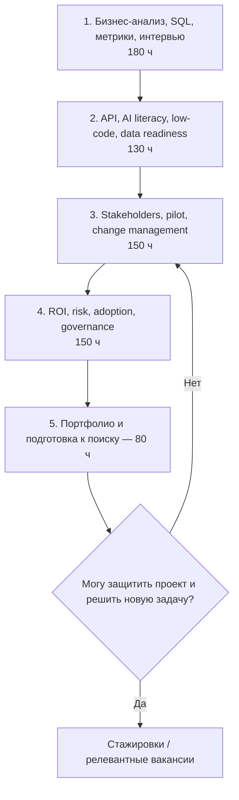

# Deployment Strategist / AI Implementation

[← Карьерный навигатор](../README.md) · [Методология рынка](../MARKET-RESEARCH.md)

> Обновлено 24.11.2026. Формирующаяся / нишевая специализация. Часы — редакционная оценка учебной нагрузки с нуля, включая практику, а не результат исследования. Стажировка и трудоустройство не гарантированы.

## Что это за работа

Специалист применяет компетенции в области «Внедрение», чтобы поставлять проверяемые результаты. Типичный учебный результат, отражающий обязанности: План внедрения AI в отдел поддержки: AS-IS, пилот, ROI, риски и adoption. На работе задачи включают api, ai literacy, low-code, data readiness, stakeholders, pilot, change management и roi, risk, adoption, governance. Конкретный набор зависит от работодателя.

**Кому подойдёт:** тем, кому интересны api, ai literacy, low-code, data readiness и stakeholders, pilot, change management. Попробуйте первое задание ниже, прежде чем покупать обучение.

**Порог входа:** выше среднего; лучше начинать со смежной роли или стажировки, а эту профессию считать целью после практического опыта. Нужна готовность учиться самостоятельно; английский для документации, международный рынок — обычно рабочий английский.

## Рынок и зарплаты

Отдельной сопоставимой статистики вакансий и медианной зарплаты по этой должности в Казахстане и СНГ в изученных агрегированных отчётах нет.

Открытые карьерные страницы OpenAI и Anthropic подтверждают наличие ролей FDE / Applied AI / Technical Deployment; Palantir публикует Deployment Strategist. Это подтверждение существования, не массового спроса. [OAI, ANT, PAL]

Если категория шире названия роли, отдельная медиана по роли неизвестна. Не переносите цифру прокси на эту профессию.

**Прогноз (редакционный, не измерение):** 2027: развитие вероятно при сохранении инвестиций в интеграции, качество и безопасность; не обещание роста вакансий. 2028–2030: возможна специализация на автономных процессах, но названия и обязанности могут измениться.

**Ограничения:** Название редкое в СНГ; многие вакансии требуют доменного опыта.

## Roadmap с нуля

| Этап | Что изучить | Часы | Практика и контроль результата |
|---|---|---:|---|
| 1 | Бизнес-анализ, SQL, метрики, интервью | 180 | Найти узкое место и определить baseline |
| 2 | API, AI literacy, low-code, data readiness | 130 | Собрать ограниченный прототип |
| 3 | Stakeholders, pilot, change management | 150 | Спроектировать rollout, обучение и обратную связь |
| 4 | ROI, risk, adoption, governance | 150 | Оценить эффект и план масштабирования |
| 5 | Портфолио, резюме, интервью, анализ вакансий | 80 | Завершить capstone, провести пробное собеседование и исправить пробелы |

**Всего около 690 ч** (плановая оценка, разумный диапазон ±25%; без коммерческого опыта). При 10 ч/нед — примерно 69 недель; при 20 ч/нед — 35 недель. Опытный специалист пропускает только этапы, которые может подтвердить самостоятельной практикой. Для продвинутых ролей коммерческий опыт может потребоваться сверх этой оценки.

### Как заниматься

- Сначала прочитать документацию и выполнить маленькое задание самостоятельно; затем попросить AI проверить решение, а не выдать ответ.
- Вести Git-репозиторий или журнал решений: задача, варианты, ошибки, вывод. Использовать только учебные либо разрешённые обезличенные данные.
- В конце каждого этапа воспроизвести работу без подсказок и объяснить ограничения решения. Если не получается — повторить практику.

## Ресурсы (приоритет бесплатным)

- [GOV.UK Service Manual](https://www.gov.uk/service-manual) — документация или учебный портал; базовые материалы доступны без покупки, отдельные функции/экзамены могут быть платными.
- [Camunda BPMN](https://camunda.com/bpmn/) — документация или учебный портал; базовые материалы доступны без покупки, отдельные функции/экзамены могут быть платными.
- [NIST AI RMF](https://www.nist.gov/itl/ai-risk-management-framework) — документация или учебный портал; базовые материалы доступны без покупки, отдельные функции/экзамены могут быть платными.

Платный вариант: ментор или курс с проверяемой программой по тем же этапам, проектом, обратной связью и прозрачным договором; сравните с бесплатными ресурсами. Платное обучение и сертификат не гарантируют качество, навыки или найм. Облачные сервисы/API, экзамены и тарифы могут требовать оплаты; проверяйте условия до регистрации.

## Портфолио

**Capstone:** План внедрения AI в отдел поддержки: AS-IS, пилот, ROI, риски и adoption.

1. Сформулировать проблему, пользователя и проверяемый критерий успеха; явно отметить учебный/синтетический характер проекта.
2. Выполнить 4 этапных мини-задания; собрать их в единый проект, указать архитектуру/процесс и принятые решения.
3. Продемонстрировать обычный сценарий и минимум три отказа/ошибки; приложить доказательства тестов, измерения или обратной связи.
4. Опубликовать README, инструкцию воспроизведения, короткое демо и ограничения; не публиковать секреты и чужие данные.

## Готовность к рынку

- [ ] Различаешь технический успех и использование людьми, можешь объяснить метрики.
- [ ] Могу выполнить итоговое задание без AI-подсказок и объяснить каждое ключевое решение.
- [ ] Есть воспроизводимый проект, документация, проверки и список известных ограничений.
- [ ] Изучил 20–30 релевантных объявлений; выделил обязательные навыки, опыт и географические ограничения; сравнил со своими доказательствами.
- [ ] Подготовил резюме с фактами и ссылками на работы, а не выдуманным опытом; прошёл пробное интервью.

**Поисковые запросы:** deployment strategist, implementation consultant, AI implementation (на русском и английском). [hh.kz](https://hh.kz/), [hh.uz](https://hh.uz/), [hh.ru](https://hh.ru/), [Хабр Карьера](https://career.habr.com/), [LinkedIn Jobs](https://www.linkedin.com/jobs/). Для международных вакансий проверяйте страну, право на работу, язык, удалённый формат и условия оплаты.

**Переходы:** BA / Automation / Product → Deployment Strategist.

## Источники рынка

- [KZ26] [hh.kz — III квартал 2026](https://hh.kz/article/34483)
- [WEF] [WEF — Future of Jobs Report 2025](https://www.weforum.org/publications/the-future-of-jobs-report-2025/)
- [OAI] [OpenAI — объявления FDE и Applied AI](https://openai.com/careers/search/)
- [ANT] [Anthropic — вакансии Applied AI, FDE, Technical Deployment](https://www.anthropic.com/careers/jobs)
- [PAL] [Palantir — вакансии Deployment Strategist](https://www.palantir.com/careers/open-positions/)

[Все источники и методология](../SOURCES.md)
