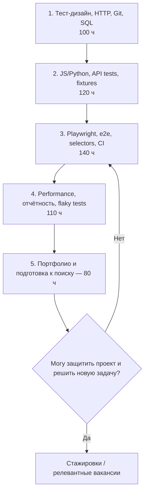

# QA Automation Engineer

[← Карьерный навигатор](../README.md) · [Методология рынка](../MARKET-RESEARCH.md)

> Обновлено 24.11.2026. Сформировавшаяся роль. Часы — редакционная оценка учебной нагрузки с нуля, включая практику, а не результат исследования. Стажировка и трудоустройство не гарантированы.

## Что это за работа

Специалист применяет компетенции в области «Качество», чтобы поставлять проверяемые результаты. Типичный учебный результат, отражающий обязанности: Автотесты интернет-магазина: API, UI, CI, отчёт о рисках. На работе задачи включают js/python, api tests, fixtures, playwright, e2e, selectors, ci и performance, отчётность, flaky tests. Конкретный набор зависит от работодателя.

**Кому подойдёт:** тем, кому интересны js/python, api tests, fixtures и playwright, e2e, selectors, ci. Попробуйте первое задание ниже, прежде чем покупать обучение.

**Порог входа:** начальный путь возможен через стажировку, junior или смежную позицию; требования проверяются по вакансиям. Нужна готовность учиться самостоятельно; английский для документации, международный рынок — обычно рабочий английский.

## Рынок и зарплаты

**Смежная категория, НЕ отдельная статистика роли:** «Тестировщик». hh.kz, 2025: доля 3.9% IT-вакансий; изменение к 2024: +16.1%; медианное предложение 233 980 ₸/мес. hh.uz, 2025: доля 5.2%; изменение +5.4%; медианное предложение 7 186 385 сум/мес. [KZ25, UZ25]. Все грейды; это не зарплата новичка.

США, BLS, май 2025: медианная годовая зарплата категории Software QA analysts and testers — $104 300 (все уровни; не предложение удалённой работы из Казахстана). [BLSDEV]

Если категория шире названия роли, отдельная медиана по роли неизвестна. Не переносите цифру прокси на эту профессию.

**Прогноз (редакционный, не измерение):** 2027: разумно развивать базовые компетенции вместе с AI-инструментами; прогноз спроса зависит от отрасли и экономики. 2028–2030: возможна трансформация задач, а не исчезновение всей профессии.

**Ограничения:** Ручные повторяемые проверки автоматизируются; QA не только клики.

## Roadmap с нуля

| Этап | Что изучить | Часы | Практика и контроль результата |
|---|---|---:|---|
| 1 | Тест-дизайн, HTTP, Git, SQL | 100 | Составить тест-план и баг-репорты |
| 2 | JS/Python, API tests, fixtures | 120 | Автотесты для CRUD и ролей |
| 3 | Playwright, e2e, selectors, CI | 140 | Создать стабильный smoke suite |
| 4 | Performance, отчётность, flaky tests | 110 | Измерить стабильность и найти причину сбоя |
| 5 | Портфолио, резюме, интервью, анализ вакансий | 80 | Завершить capstone, провести пробное собеседование и исправить пробелы |

**Всего около 550 ч** (плановая оценка, разумный диапазон ±25%; без коммерческого опыта). При 10 ч/нед — примерно 55 недель; при 20 ч/нед — 28 недель. Опытный специалист пропускает только этапы, которые может подтвердить самостоятельной практикой. Для продвинутых ролей коммерческий опыт может потребоваться сверх этой оценки.

### Как заниматься

- Сначала прочитать документацию и выполнить маленькое задание самостоятельно; затем попросить AI проверить решение, а не выдать ответ.
- Вести Git-репозиторий или журнал решений: задача, варианты, ошибки, вывод. Использовать только учебные либо разрешённые обезличенные данные.
- В конце каждого этапа воспроизвести работу без подсказок и объяснить ограничения решения. Если не получается — повторить практику.

## Ресурсы (приоритет бесплатным)

- [ISTQB](https://www.istqb.org/) — документация или учебный портал; базовые материалы доступны без покупки, отдельные функции/экзамены могут быть платными.
- [Playwright](https://playwright.dev/docs/intro) — документация или учебный портал; базовые материалы доступны без покупки, отдельные функции/экзамены могут быть платными.
- [Postman](https://learning.postman.com/) — документация или учебный портал; базовые материалы доступны без покупки, отдельные функции/экзамены могут быть платными.

Платный вариант: ментор или курс с проверяемой программой по тем же этапам, проектом, обратной связью и прозрачным договором; сравните с бесплатными ресурсами. Платное обучение и сертификат не гарантируют качество, навыки или найм. Облачные сервисы/API, экзамены и тарифы могут требовать оплаты; проверяйте условия до регистрации.

## Портфолио

**Capstone:** Автотесты интернет-магазина: API, UI, CI, отчёт о рисках.

1. Сформулировать проблему, пользователя и проверяемый критерий успеха; явно отметить учебный/синтетический характер проекта.
2. Выполнить 4 этапных мини-задания; собрать их в единый проект, указать архитектуру/процесс и принятые решения.
3. Продемонстрировать обычный сценарий и минимум три отказа/ошибки; приложить доказательства тестов, измерения или обратной связи.
4. Опубликовать README, инструкцию воспроизведения, короткое демо и ограничения; не публиковать секреты и чужие данные.

## Готовность к рынку

- [ ] Можешь выбрать подходящий уровень теста и локализовать причину.
- [ ] Могу выполнить итоговое задание без AI-подсказок и объяснить каждое ключевое решение.
- [ ] Есть воспроизводимый проект, документация, проверки и список известных ограничений.
- [ ] Изучил 20–30 релевантных объявлений; выделил обязательные навыки, опыт и географические ограничения; сравнил со своими доказательствами.
- [ ] Подготовил резюме с фактами и ссылками на работы, а не выдуманным опытом; прошёл пробное интервью.

**Поисковые запросы:** QA automation, SDET junior, тестировщик (на русском и английском). [hh.kz](https://hh.kz/), [hh.uz](https://hh.uz/), [hh.ru](https://hh.ru/), [Хабр Карьера](https://career.habr.com/), [LinkedIn Jobs](https://www.linkedin.com/jobs/). Для международных вакансий проверяйте страну, право на работу, язык, удалённый формат и условия оплаты.

**Переходы:** AI Evaluation / SDET / Security.

## Источники рынка

- [KZ26] [hh.kz — III квартал 2026](https://hh.kz/article/34483)
- [WEF] [WEF — Future of Jobs Report 2025](https://www.weforum.org/publications/the-future-of-jobs-report-2025/)
- [KZ25] [hh.kz — IT, итоги 2025](https://hh.kz/article/34221)
- [UZ25] [hh.uz — IT, итоги 2025](https://hh.uz/article/34221)
- [BLSDEV] [BLS — software developers and QA, May 2025](https://www.bls.gov/ooh/computer-and-information-technology/software-developers.htm)

[Все источники и методология](../SOURCES.md)
